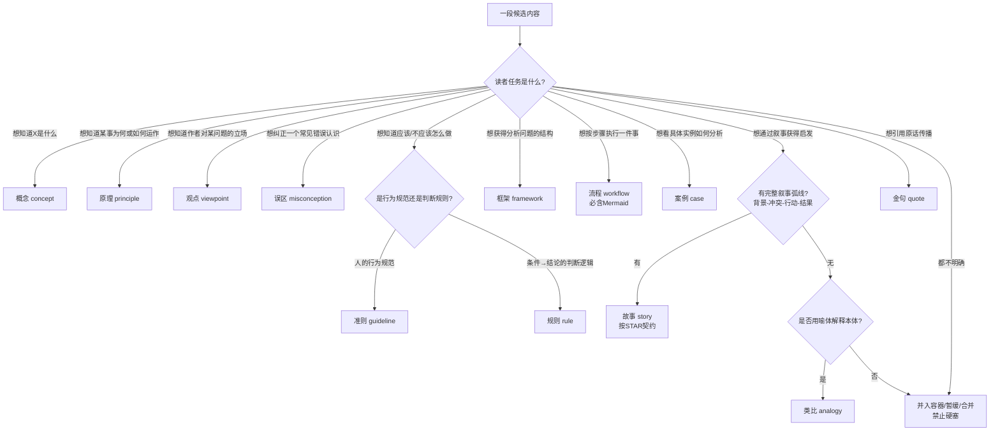

# 超云知识库构建器

## 目标

把以“存放和阅读”为中心的零散资料，转换为以“检索、调用和应用”为中心的知识系统：

`主题画像 → 来源登记 → 碎片标准化 → 相关性过滤 → 跨源聚类 → 去重与冲突 → 原子组件 → 多源溯源 → 依赖索引 → 应用范式 → 发布复核`

## 快速入口

确定性工作由脚本执行，语义工作由 Agent 完成。

本机必须使用本 Skill 目录下的 Python 3.11 虚拟环境，不要用系统默认的 Python 3.14（`markitdown>=0.1.3` 无法安装）：

```text
C:\Users\QIQI\.cursor\skills\chaoyun-knowledge-base-builder\.venv\Scripts\python.exe
```

```text
.venv\Scripts\python.exe scripts/build_kb.py run <来源目录> <输出目录> --kb-id <稳定英文ID> --title <知识库名> --question <中心问题> --include <纳入主题>
```

`run` 默认只摄取前 3 个文件做试点，并完成初始化、跨格式转换、来源登记、碎片生成和准备阶段校验。随后 Agent 必须：

1. 复核 `uncertain` 和低置信度碎片。
2. 建立跨源聚类、去重、冲突和 `mappings.jsonl`。
3. 按类型契约生成 `components/`、索引和关系。
4. 执行 `.venv\Scripts\python.exe scripts/build_kb.py release <输出目录>`；只有门禁通过才能使用 `--publish`。

工具职责：

- `build_kb.py`：初始化、试点、摄取、验证、状态和发布编排。
- `ingest_sources.py`：文本直读；PDF、Office、图片、音视频等通过 MarkItDown 转换；失败写入隔离报告。
- `create_review_queue.py`：把转换失败、低置信度碎片和未决冲突输出为 Agent/人工待办。
- `build_indexes.py`：从组件元数据幂等重建总索引、类型索引和机器关系表。
- `validate_components.py`：校验两套 Schema、来源哈希、锚点、交叉引用、孤儿、依赖环、冲突和领域风险。
- `component-schema.json` 与 `pipeline-schema.json`：组件和五类流水线对象的严格机器契约。

## 开始前

1. 确认主题、目标用户、要解决的任务、来源目录、输出目录、格式和发布要求。
2. 先创建 `kb-profile.yaml`，声明纳入/排除边界、领域画像、风险级别与相关性判定阈值；边界不清时只盘点，不开始拆分。
3. 判断目标是检索型、学习型、问答型、研究型、决策辅助型还是应用工作流型知识库。
4. 默认保留原始目录不修改，在独立目录中重构；派生文本不得覆盖原始文件。
5. 确认是单一知识库还是多个独立知识库；对多库项目，先声明每库边界和跨库重复策略。
6. 多格式、多来源或零碎资料必须读取并执行 [fragment-workflow.md](fragment-workflow.md)；跨领域裁剪读取 [domain-profiles.md](domain-profiles.md)。
7. 读取 [reference.md](reference.md) 获取完整规范；需要交付示例时读取 [examples.md](examples.md)。
8. 新建或重审组件采用 [taxonomy-v2.md](taxonomy-v2.md)；以 `component-schema.json` 和 `pipeline-schema.json` 约束产物，并使用 `scripts/validate_components.py` 校验。
9. 任务涉及大量文件或架构取舍时，先进入计划模式，选代表性来源试点，再按批次实施。
10. 增量更新只重建受影响的碎片、组件和索引；发布时仍生成不可变快照与版本差异报告。
11. 分类法、正文契约和门禁演化执行 [evolution-policy.md](evolution-policy.md)；受监管领域的专业门禁不得由 AI 自主降级或代替具名专业审核。
12. Schema、分类法、Builder 和画像版本必须符合 [versioning.md](versioning.md) 的稳定组合。
13. 只询问会实质改变结果的事项；模式、默认值、暂停点和阶段反馈按 [interaction-protocol.md](interaction-protocol.md) 执行。

## 强制原则

- 原文不可丢失：每个组件必须能定位到来源文件和原始范围。
- 先分流再拆分：每个来源碎片必须被标记为 `mapped`、`context-only`、`deferred` 或 `excluded`，禁止无声遗漏。
- 多源不抹平：语义相似只生成合并候选；条件、时间、辖区、版本或结论不同的主张保持独立。
- 冲突显式化：相互支持、反驳、替代或废止的来源必须保留关系和冲突状态，不得为得到单一答案而静默合并。
- 结构与内容分离：生成器可写元数据、索引和脚手架，不擅自重写原意。
- 一组件一职责：每个叶子组件只表达一个可独立调用的知识单元。
- 稳定 ID 优先：移动文件或修改标题不得轻易改变组件 ID。
- 事实分层：区分原文摘录、忠实改写、整理者补充、整理者推断和外部事实；不得把整理者补充伪装为原文主张。
- 金句不脱语境：金句组件必须逐字保留原文、记录出处语境，并关联其浓缩的知识组件。
- 依赖有语义：`depends_on` 仅放必需前置，`related` 仅放辅助关联。
- 分类走门禁：每个类型有准入门禁和排除条件；不满足门禁的内容禁止降格塞入"最像"的类型，只能并入容器、合并或暂缓。
- 用户价值完整：每个叶子组件必须说明它是什么、为什么重要、如何识别或进入、如何使用、不能推出什么、下一步调用什么；正文信息点以 `reference.md` 的“类型信息标准 v2”为准。
- 可视化有证据：流程必须有 Mermaid；其他组件仅在关系、层级、分支、映射、时间序列或证据链会显著降低理解成本时加入图示，并标识图示层级（原文图示／忠实整理图／整理者解释图）。
- 迭代可比较：每次重生成保留上版，记录输入指纹、标准版本、组件映射、增删改、重分类、关系变化与校验差异；用户要求可视化审计时，所有叶子组件必须有 Mermaid 图。
- 自治演化可逆：AI 可以发布类型/契约/门禁变更，但只能通过回归、迁移、评分和回滚门槛，不得覆盖稳定版本或删除失败证据。
- 重复治理分层：同一知识库内应合并重复知识并保留别名/来源关系；多个独立知识库之间可以因课程边界、目标读者或表述语境不同而保留重复组件，不强制跨库合并。
- 边界先行：健康、安全、工程、法律、财务、隐私等内容必须设置专业门禁；高风险组件未获所需专业审核只能保持草稿、补证或转介状态。
- 允许不确定：输出可以是补证、暂缓、不执行、冲突、无法判断或停止。
- 验收不等于复核：自动校验通过不能把未经人工审阅的内容升级为“已复核”。

## 零碎多源资料的五个机器对象

1. `KBProfile`：主题边界、用户任务、领域画像、风险策略。
2. `SourceRevision`：来源身份、版本、格式、指纹、解析方法和质量。
3. `Fragment`：不可变原文、规范化文本、通用锚点、相关性与处置。
4. `MappingDecision`：聚类、去重、冲突、排除、暂缓及组件映射决策。
5. `Component`：原子知识、多来源证据、关系、版本、风险和发布状态。

固定中间产物与详细字段见 [fragment-workflow.md](fragment-workflow.md)。缺少来源清单、碎片清单或映射决策时，不得声明全量结构化完成。

## 多知识库边界

当一个课程体系拆成多个知识库时，先为每库建立 `kb_id`、名称、范围、目标读者、允许来源和排除范围。每库独立维护 ID 命名空间、索引、依赖图、验收和复核状态。

- **允许跨库重复**：相同概念可以在不同课程库中分别存在，以保留该课程的教学语境、表达层次和调用闭环。
- **禁止机械复制**：跨库重复组件必须各自有本库来源锚点、课程语境说明和本库独立 ID；不能只复制正文后改路径。
- **库内仍须去重**：同库内的同一主张、规则或案例应选定 canonical 组件，其余内容以 `variant_of`、别名或来源证据关联。
- **不跨库建立强依赖**：默认 `depends_on` 只指向本库；若需要跨库导航，使用总导航或明确的跨库阅读说明，不用隐式强依赖。

## 命名规则

命名分为三层，不能混淆：

- **ID 层**：稳定机器标识，使用小写英文，例如 `foundation.concept.bazi-sizhu`；标题、文件移动或文件名调整不得改变 ID。
- **目录层**：面向中文用户时优先使用中文编号分类，例如 `02-概念/`、`08-规则/`、`来源/`；项目已有稳定约定时可沿用，但同库必须一致。
- **文件层**：使用中文，便于文件管理器、全文搜索和人工浏览。

文件层统一规则：

```text
课程容器：第NN课-主题.md
主题容器：主题集-主题.md
课程前言：前言-主题.md
课程变体：第NN课-主题-修订版.md
叶子组件：类型-主题.md
需要消歧：类型-主题-限定.md
```

示例：

```text
02-概念/概念-用户需求.md
03-原理/原理-反馈回路.md
06-准则/准则-避免诱导式访谈.md
08-规则/规则-重试条件.md
09-流程/流程-事故响应.md
13-案例/案例-需求验证失败复盘.md
主题/主题集-用户研究.md
```

- 即使目录已表达类型，叶子组件仍必须保留中文类型前缀，确保文件被单独搜索、复制或引用时可辨识。
- `title` 使用自然中文；文件名是 `title` 的安全化、简化版，不必逐字相同。
- 限定仅用于消除重名或表达必要场景，禁止把整句说明塞进文件名。
- 不得以“第几课、第几段、第几页”等来源位置重复污染组件文件名；位置保留在 `title` 或 provenance 锚点。
- 文件名不得含 Windows 非法字符 `< > : " / \ | ? *`；使用中文书名号、引号、问号或冒号的标题须安全化为简短主题。禁止连续空格、截断在“与 / 的 / ：”等连接词后。
- Markdown 链接显示文本使用中文类型与标题（如 `[术语：墓库]`），不得向读者暴露 `concept-muku` 之类的 slug。

## 标准工作流

### 1. 建立主题与领域画像

- 建立 `kb-profile.yaml`：中心问题、纳入/排除主题、目标用户、目标任务、领域画像、风险级别、辖区和发布门禁。
- 选择 `general` 或 [domain-profiles.md](domain-profiles.md) 中的适配画像；类型表达知识功能，领域画像只增加字段、门禁和验收，不能改变核心类型语义。
- 用正例、负例和边界样本校准相关性判断；不确定项进入复核队列。

产物：主题契约、领域画像、相关性标准、风险门禁。

### 2. 冻结、登记与规范化来源

- 只读扫描原始内容库。
- 为每个来源及修订版分配 `source_id`、`revision_id`，记录格式、SHA-256、标题、作者、日期、版本、许可、解析方法和质量。
- PDF、网页、音视频、表格等先转换为可定位的派生文本；格式适配器能提供时保留页码、幻灯片、时间码、单元格或选择器，否则使用派生文本行锚点并登记转换损失。
- 切分为不可变原文碎片；清洗后的规范化文本与原文分开保存，并记录每项转换。
- 明确禁止写入的原始目录和允许写入的重构目录。

产物：`sources.jsonl`、`fragments.jsonl`、风险清单、来源基线。

### 3. 相关性分流、聚类与冲突发现

- 按主题契约将碎片标为 `include`、`contextual`、`exclude` 或 `uncertain`，记录置信度和理由。
- 先抽取候选主张和主读者任务，再跨来源聚类；聚类是候选关系，不自动等于合并。
- 区分完全重复、同义改写、上下位、范围差异、版本更新和相互矛盾。
- 对每个碎片做 `mapped`、`context-only`、`deferred` 或 `excluded` 处置；暂缓和排除必须有理由。

产物：`mappings.jsonl`、`conflicts.jsonl`、聚类与去重决策。

### 4. 定义组件 Schema

至少定义：

- `id`、`type`、`role`、`title`、`summary`
- `provenance[]`（多来源、修订、锚点、证据角色、提取方式）；旧项目可暂用 `source_file/source_lines/source_sha256`
- `canonical`、`variant_of`
- `applies_to`、`tags`
- `depends_on`、`related`
- `evidence_level`、`status`、`severity`
- `taxonomy_version`、`content_layers`、`editorial_additions`

使用本 skill 的 `component-schema.json` 作为默认机器可读 Schema；项目可扩展字段，但不得放宽其中的必填字段、受控类型和来源层级要求。正文必备章节和受控枚举以 `reference.md` 的类型契约为准。

类型重审或演进必须记录 `taxonomy_version`。重分类时 ID 默认稳定；若必须替换 ID，使用 `deprecated`、`deprecated_by`、`supersedes` 和 `migration_log`，完整规则见 [taxonomy-v2.md](taxonomy-v2.md)。

不要在 Schema 中设置“每课固定产出 N 个组件”之类的数量配额；组件数量必须由来源中的独立读者任务和知识边界决定。

### 5. 设计分类体系

分类必须以**读者任务**为入口，不以内容表面形态判断（有人名≠故事，有条款≠规则，有定义≠概念）。每个类型都有**准入门禁**和**排除条件**；内容不满足任何门禁时，禁止降格塞入"最像"的类型，只能并入课程容器、与相邻内容合并或标记暂缓。

默认考虑以下类型，按项目需要裁剪：

- 概念、原理、观点、误区、准则
- 框架、规则、流程、工具、数据
- 方案、场景、案例、类比
- 边界、溯源、故事
- 金句
- 范式、元数据

角色至少区分：`leaf`、`container`、`preface`、`meta`。

#### 分类判定决策树



#### 类型判定要点

> 决策树流程图另存为 [判定决策树.jpg](判定决策树.jpg)，可独立查看与分享。

- **概念 vs 原理**：概念回答"是什么"，原理回答"为什么/如何运作"且陈述不以人的意志为转移的机制。
- **原理 vs 观点**：原理是客观机制，观点是作者对有争议问题的立场。
- **观点 vs 误区**：观点只有正面主张，误区必须有"误区陈述→纠正"的明确对照。
- **准则 vs 规则**：准则约束人的行为（应该/禁止），规则是领域内“条件→结论”的判断逻辑。
- **框架 vs 流程**：框架给分析维度和组成部分，流程给可执行的步骤序列（必含 Mermaid）。
- **案例 vs 故事**：案例有具体事实和分析过程，故事有 STAR 叙事弧线。
- **故事 vs 类比**：故事必须有背景、冲突、行动、结果四要素；只有情境对举或喻体映射的归类比。
- **金句**：逐字原文 + 出处语境 + 关联知识组件，缺一不可；只摘漂亮句子不挂语境和关联的是素材堆，不是金句组件。

金句是"原文 + 出处语境 + 指向关联"的复合单元：原文逐字保留，语境说明"何时、何课、为何而说"，并通过 `related` 关联其浓缩的原理或规则组件。

各类型的准入门禁、排除条件和正文必备章节详见 [reference.md](reference.md) 的"类型契约"章节。

### 6. 先做拆分映射与试点

在写任何叶子组件前，为每个来源建立机器可读的拆分映射。映射至少记录：

- 来源文件、来源 SHA-256、行范围
- 候选组件 ID、类型、角色和主读者任务
- 拆分理由（为何独立、为何不与相邻段落合并）
- 与已有组件的关系（新建、canonical、variant、别名、待人工判断）
- 覆盖状态（已映射 / 暂缓 / 不拆分及理由）

先选一个有代表性的来源集合做小试点（建议 1～3 课，覆盖术语、规则、案例等），完成“映射 → 组件 → 自动校验 → 分层人工抽检”后，再由用户或明确的验收门禁决定是否迁移其余批次。不得先并行全量生成、再集中修补。

### 7. 分批组件化

推荐顺序：

1. 概念与数据
2. 原理、观点、误区、准则、框架、工具、流程
3. 溯源、类比、故事与安全边界
4. 规则原子化及重复治理
5. 方案、场景和案例
6. 金句提取与关联
7. 全局索引、依赖与范式

每批完成后立即做结构校验和语义抽检，不把所有错误留到最后。每批的进入条件必须是：拆分映射完整、重复决策明确、前一批硬错误为零、抽检问题已登记。

### 8. 原子化与纠偏

- 按"一条定义、一条规则、一个工具、一个方案、一个案例"拆分叶子组件。
- 将章节目录、前言和主题合集保留为容器。
- 合并**同库**重复内容，保留别名与来源关系；跨库重复按"多知识库边界"处理。
- 修正类型误判，但不因目录名称机械决定类型。
- 分类必须通过准入门禁：不满足门禁的内容禁止降格塞入"最像"的类型，只能并入容器、合并或暂缓。
- 故事类必须有 STAR 叙事弧线（背景、冲突、行动、结果）；只有情境描写无冲突转折的归类比或并入容器。
- 规则必须声明条件、输入、结论强度、例外和边界。

### 9. 建立溯源和证据层

- 为每个组件记录全部来源、修订版、锚点和证据角色；允许一组件多来源、一来源多组件。
- 保留可逆原文摘录或稳定锚点。
- 分栏记录事实、原文主张、案例和整理者推断。
- 对支持、反驳、语境、示例和推导依据分别标记；跨源综合必须声明为忠实综合或整理者推断。
- 无法确认的来源明确标记，不补造出处。

### 10. 建立依赖网络

- 解析组件间前置、引用、容器、变体和场景关系。
- 检查不存在的目标、重复 ID、强依赖环和跨批遗漏。
- 生成机器可读依赖图及人类可读导航。

### 11. 建立索引和用户导航

至少生成：

- 组件总表
- 类型、领域、证据、风险索引
- 数据与工具索引
- 依赖图
- 初学者、实践者、研究者或项目专属导航

### 12. 建立应用范式

对应用型知识库采用两层模型：

- 场景范式：识别问题、声明门禁、组合任务。
- 通用任务：定义勘察、分析、决策、方案、实施、复核、复盘、研究等执行协议。

范式只编排组件，不复制知识规则正文。

### 13. 定义输入输出契约

每个任务或场景必须明确：

- 适用条件和必填输入
- 前置门禁与现实否决项
- 调用顺序和判断分支
- 具名产物及验收字段
- 停止、回退和转介条件
- 责任人、时间窗、指标和复核状态

### 14. 全量验证

至少检查：

- 准备阶段运行 `python scripts/build_kb.py validate <知识库根目录>`；发布阶段运行 `python scripts/build_kb.py release <知识库根目录>`
- 校验组件与流水线 Schema、必填字段、受控值、来源/碎片/映射交叉引用和正文契约
- 拆分映射覆盖率：来源行段是否已映射、暂缓或明确不拆分；是否存在无映射组件
- 处置覆盖率必须为 100%；报告有效孤儿碎片、无来源组件和未解决冲突
- ID 唯一性、路径、链接、图片引用
- 依赖目标、强依赖环、跨批闭环
- 来源锚点和原文可逆性
- 组件语义质量：原子性、类型适配、原文忠实度、条件/例外完整性、重复处理和关系语义
- 索引覆盖率与孤立组件
- 风险标注、专业门禁和过度承诺
- 增量影响集：新增、修改、删除来源是否只影响可解释的碎片、组件与索引
- 生成脚本幂等性
- 分层人工抽检
- 分类回归测试：按 [taxonomy-regression.md](taxonomy-regression.md) 逐例盲判；任一硬门禁案例错分时，禁止扩大迁移范围

自动校验只覆盖结构；语义质量必须做分层人工抽检。发现问题后修复并重新全量验证，直到硬错误为零，且抽检结果达到预设门槛。

### 15. 发布、交付与状态声明

交付：

- 重构知识库
- Schema 与组件模板
- 来源清单、来源指纹与拆分映射
- 主题画像、碎片清单、聚类去重决策、冲突清单
- 索引、依赖图和导航
- 范式与工作流
- 自动校验报告
- 人工抽检记录
- 覆盖率与遗留问题清单
- `release-manifest.json`：输入指纹、Schema/分类法/画像/工具版本、指标、阻断项与发布状态

明确区分“已采集、已整理、已复核”等状态，不因项目完成而批量虚增成熟度。

## 执行检查点

- [ ] 原始内容目录未被修改
- [ ] 每个独立知识库已声明范围、读者、来源和跨库重复策略
- [ ] `kb-profile.yaml` 已声明纳入/排除边界、领域画像、风险和相关性标准
- [ ] 每个来源修订版和碎片都有稳定 ID、通用锚点、指纹与解析质量记录
- [ ] 每个碎片已有 `mapped/context-only/deferred/excluded` 处置，覆盖率为 100%
- [ ] 聚类未被直接当作合并；范围差异、版本差异与冲突已显式保留
- [ ] ID、中文目录、中文文件名三层命名符合规则；课程容器和叶子组件文件名格式统一
- [ ] 文件名安全化、链接显示文本中文化；无旧英文目录名或 slug 暴露给读者
- [ ] 每个来源均有内容指纹和拆分映射；未映射内容有暂缓或不拆分理由
- [ ] 每个组件都有稳定 ID 和可解析来源
- [ ] 多来源组件记录全部 `provenance` 及证据角色，跨源综合未伪装成单一来源原话
- [ ] 每个组件记录 `taxonomy_version` 和 `content_layers`；整理者补充、推断与外部事实未伪装为原文
- [ ] 重分类或废弃组件具备迁移记录；旧 ID 的弃用与替代关系可解析
- [ ] 叶子组件职责单一，容器关系清晰
- [ ] 每个组件类型通过准入门禁；不满足门禁的内容已并入容器、合并或暂缓
- [ ] 故事类组件具备 STAR 叙事弧线；类比类组件有映射表和失效边界
- [ ] 证据等级和整理者补充明确分离
- [ ] 强依赖与辅助关联未混用
- [ ] 高风险内容有专业门禁
- [ ] 高风险内容未以 AI 审核代替所需的具名专业批准
- [ ] 金句组件有出处语境和至少一个知识组件关联
- [ ] 索引覆盖全部组件
- [ ] 应用范式具备输入、分支、产物和停止条件
- [ ] 原文、链接、依赖和结构校验通过
- [ ] `build_kb.py release` 通过；分类回归测试集的硬门禁案例全部通过
- [ ] 人工抽检覆盖全部类型、角色、风险和批次
- [ ] 人工抽检同时检查原子性、类型适配、忠实度、关系语义与重复治理
- [ ] 未把自动验收等同于人工复核

## 禁止做法

- 直接覆盖原始内容库。
- 为追求结构整齐而改写原意。
- 仅按文件夹名称批量判断组件类型。
- 以"每课固定 N 个组件"替代原子化判定。
- 把不满足门禁的内容降格塞入"最像"的类型（如把误区当原则、把情境对举当故事）。
- 未建立拆分映射和试点门禁就并行全量生成，再集中修补。
- 根据向量相似度或文字相似度自动合并主张。
- 静默删除重复、冲突、低质量或不确定碎片以提高覆盖率。
- 将解析、OCR 或 ASR 后的文本冒充不可变原文。
- 把整章内容伪装成原子规则。
- 用案例证明因果，或用结果反推规则。
- 用 `related` 掩盖缺失的必需依赖。
- 为消除冲突而删除反例、不确定项或失败记录。
- 把金句抽离语境，当作独立知识规则或普适结论使用。
- 在没有来源证据时补写出处、版本或现代效力。
- 只生成目录和标签，却没有可执行的输入输出契约。

## 完成标准

只有同时满足以下条件才可声明结构化完成：

1. 内容可追溯。
2. 组件可独立调用。
3. 关系可机器解析。
4. 用户可按目标导航。
5. 工作流可执行、停止和复核。
6. 风险边界明确。
7. 全部碎片有处置，多源溯源、去重与冲突决策可审计。
8. 自动校验、分层人工抽检和适用的专业门禁均通过。
